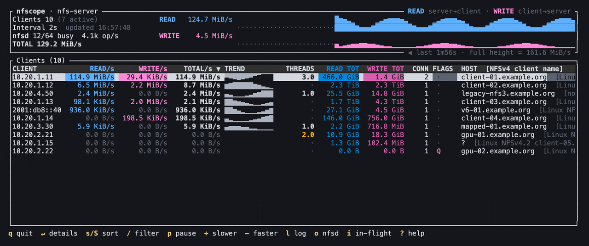
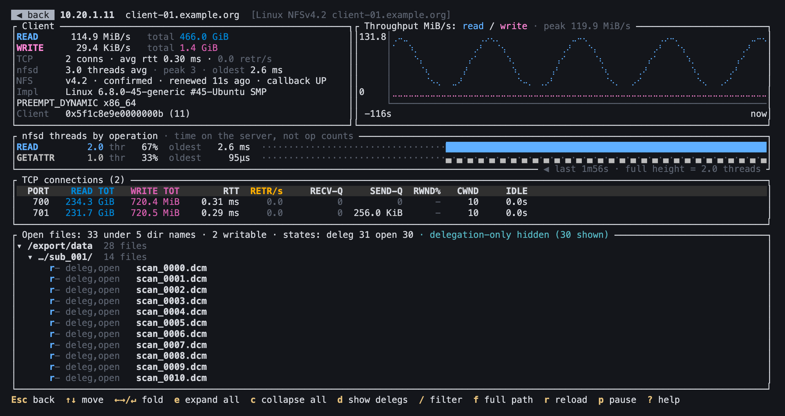
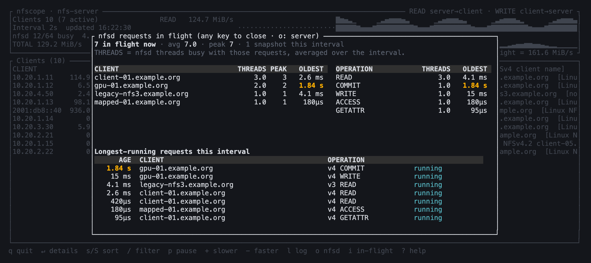
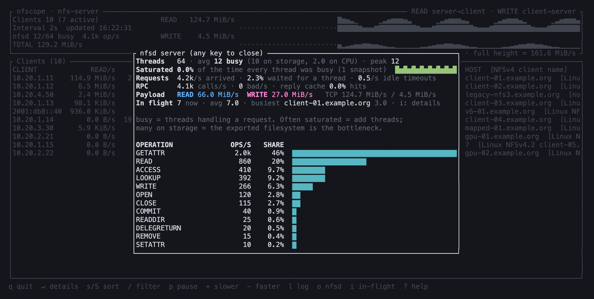

# nfscope

**`top` for Linux NFS servers.** See which clients are moving data, which ones are tying up
the nfsd threads, and what files they have open — live, from the server itself.

[](LICENSE)




## Why

When an NFS server slows down, `nfsstat` and your dashboards tell you *that* it is busy, not
*who* is making it busy. nfscope shows it on one screen:

- **Who is moving data:** read/write throughput per client, with history. nconnect and
  multi-homed servers are handled.
- **Who is holding the server:** nfsd threads busy per client and per operation, and the
  slowest requests in flight right now.
- **What they have open:** each client's open files, grouped by export and directory, with
  full paths on demand.
- **Where the problem is:** thread saturation vs. slow storage, and per-client TCP flags for
  backed-up queues, packet loss and window limits.

It reads only kernel interfaces (`/proc`, sock_diag and nfsd netlink). No packet capture, no
eBPF, nothing to install on clients. One static ~5 MB binary.

| Client drill-down | Requests in flight | Server health |
|---|---|---|
| [](docs/client.png) | [](docs/inflight.png) | [](docs/server.png) |

## Install

Download the static binary on the NFS server (no dependencies, any distribution):

```sh
curl -fLo /usr/local/sbin/nfscope \
  "https://github.com/dheshanm/nfscope/releases/latest/download/nfscope-$(uname -m)-unknown-linux-musl"
chmod +x /usr/local/sbin/nfscope
```

Each [release](https://github.com/dheshanm/nfscope/releases) lists `SHA256SUMS` for checking the
download.

**Or build it** on any machine (no Docker or extra linker needed) and copy it over:

```sh
git clone https://github.com/dheshanm/nfscope && cd nfscope
rustup target add x86_64-unknown-linux-musl
cargo build --release --target x86_64-unknown-linux-musl
scp target/x86_64-unknown-linux-musl/release/nfscope root@SERVER:/usr/local/sbin/
```

## Usage

```sh
sudo nfscope                        # on the NFS server
nfscope --fixture tests/fixtures    # demo on synthetic data, any OS (cargo run -- --fixture …)
```

| Key | | Key | |
|---|---|---|---|
| `Enter` | open a client | `o` | nfsd server health |
| `s` / `S` | sort / reverse | `i` | requests in flight |
| `/` | filter | `f` | find a file's full path |
| `+` / `-` | sampling interval | `p` | pause |
| `?` | all keys | `q` | quit |

The mouse works too: click a header to sort, double-click a row to open it. Options: `-i SECS`, `--port`,
`--no-dns`, `--no-mouse`, `--log PATH`.

**[User guide →](docs/GUIDE.md)** how to read every view, the TCP flags, the open-files tree
and where each number comes from.

## Requirements

- A Linux **kernel NFS server** (knfsd). NFS-Ganesha and NAS appliances are not supported.
- **root** for open files, client records and in-flight requests. Throughput and TCP flags
  work without it.
- NFSv4 for open files and client names. NFSv3 clients get throughput, connections and
  threads.
- Requests in flight need Linux 6.7+, or a backport such as the RHEL/Rocky/Alma 9.8 kernel.
  Everything else works on older kernels.

Developed and tested on Rocky Linux 9.8 (kernel 5.14) serving NFSv4.2.

## Compared with

| Tool | What it shows |
|---|---|
| `nfsstat` | server-wide counters, no per-client view |
| `nfsiostat` | per-mount stats, on each *client* |
| `nfswatch` | per-client traffic by packet capture; NFSv3 only, unmaintained |
| `nfsdtop` / `nfstop` scripts | per-client I/O via bpftrace or SystemTap; needs a tracing toolchain |
| node_exporter nfsd collector | server-wide totals over time |

nfscope combines per-client throughput, nfsd thread usage, in-flight requests and open files in
one live view, without capture or tracing.

## Contributing

See [CONTRIBUTING.md](CONTRIBUTING.md): tests, running on synthetic fixtures, capturing a
real server safely, and the code layout.

## License

[Unlicense](LICENSE) (public domain).
