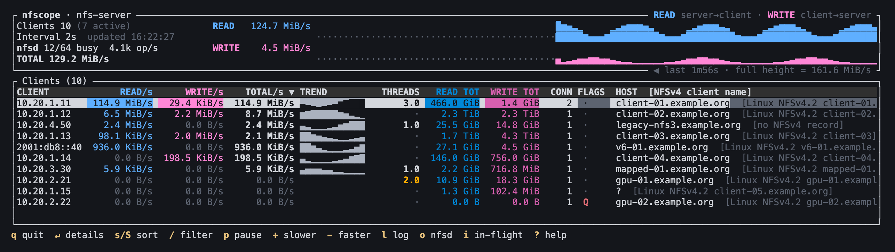
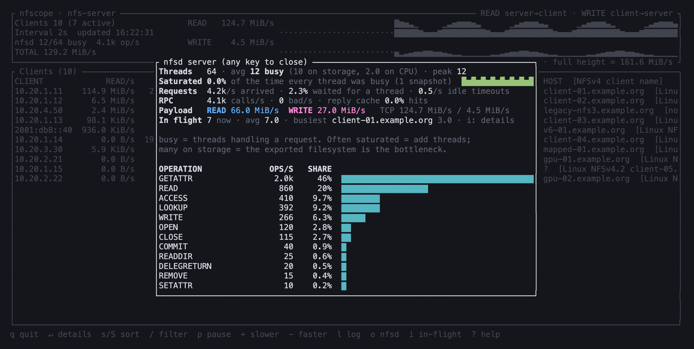
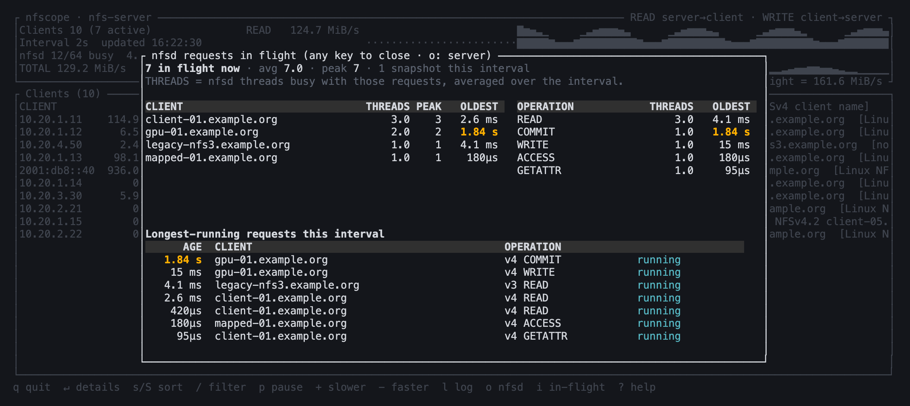
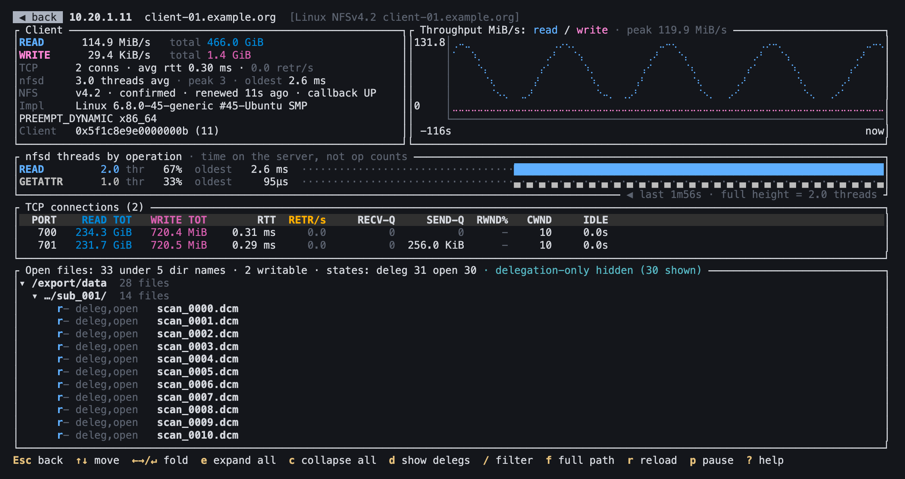

# nfscope user guide

How to read each view, where the numbers come from, and every key. For installation see the
[README](../README.md).

- [The main view](#the-main-view)
- [nfsd server health (`o`)](#nfsd-server-health-o)
- [Requests in flight (`i`)](#requests-in-flight-i)
- [Client drill-down (`Enter`)](#client-drill-down-enter)
- [The open-files tree](#the-open-files-tree)
- [TCP flags](#tcp-flags)
- [Keys and mouse](#keys-and-mouse)
- [Options, permissions and logs](#options-permissions-and-logs)
- [Where the data comes from](#where-the-data-comes-from)

## The main view



**Colours:** blue is always READ (server → client, the client is reading) and pink is always
WRITE (client → server). This holds everywhere: header graphs, table columns, the drill-down
chart, connection totals and the `r`/`w` flags in the open-files tree.

**Header graphs** show server-wide throughput, READ on top and WRITE below, on one shared scale
so their heights compare directly. One column is one sample, newest on the right. The bottom
border says how much time the graph covers and what full height means. Dots mark samples not
collected yet, or idle periods.

**nfsd line** (`nfsd 14/128 busy ↑41  4.1k op/s`):

- **14/128 busy** is the *average* number of nfsd threads handling a request during the
  interval. A thread is busy when it is on a CPU or blocked (D state, usually waiting on the
  exported filesystem). nfscope samples thread states about 10 times per interval, so short
  bursts are not missed. **↑41** is the busiest sample.
- It turns orange at 50% busy and red at 80%, or red whenever every thread was busy in at
  least 10% of the samples.
- **op/s** is RPC calls per second; one NFSv4 COMPOUND counts as one call.

**Client table**, one row per client IP:

| Column | Meaning |
|---|---|
| READ/s, WRITE/s, TOTAL/s | Throughput over the last interval, summed over all the client's connections (nconnect is handled). |
| TREND | Recent total throughput. |
| THREADS | nfsd threads busy with this client's requests, averaged over the interval (needs [in-flight data](#requests-in-flight-i)). It is request rate × request time, so a client with modest throughput but slow requests can hold more threads than the busiest one by MiB/s. Orange: one of its requests has been running for a second or more. |
| READ TOT, WRITE TOT | Bytes moved since the connections were opened. |
| CONN | TCP connections. |
| FLAGS | TCP trouble, see [TCP flags](#tcp-flags). |
| HOST | Reverse DNS, then the NFSv4 client name. Failed lookups are retried after 2 minutes; names are refreshed hourly. |

`s`/`S` or a click on a header sorts; `/` filters by host.

**Stale data is called out.** nfsd thread states, `pool_stats` and the in-flight dump are read
on a thread of their own, because the kernel serialises them with nfsd restarts and resizes
(`rpc.nfsd N`) and they can hang when a thread is stuck on storage. Client rates keep updating,
and an orange banner says *nfsd not answering for 12s*. If no sample arrives for twice the
interval, a red banner says the sampler is stuck and how old the numbers are.

## nfsd server health (`o`)



Press `o`, or click the nfsd line:

- busy threads split into on-storage and on-CPU, with a history graph;
- **Saturated**: the share of samples with no idle thread;
- request and timeout rates, and the share of requests that waited for a thread (on kernels
  whose `pool_stats` reports it);
- RPC calls and the reply cache;
- nfsd payload bytes next to TCP bytes;
- the busiest operations, NFSv3 and NFSv4 merged. Per-request bookkeeping ops (PUTFH,
  SEQUENCE, …) are left out.

**Reading it:** if saturation is often high, the server needs more threads (`rpc.nfsd N`, or
`threads=` in `/etc/nfs.conf`). If many threads are on storage while saturation stays near 0%,
the storage behind the exports is the bottleneck, and more threads won't help.

`pool_stats` is not used for "busy": on recent kernels and RHEL 9 backports its
`sockets-enqueued` counts every transport wake-up, so it can be many times `packets-arrived`.

## Requests in flight (`i`)



"14/128 busy" says how loaded the server is; the in-flight view says **who** is loading it.
nfscope asks the kernel which RPC each nfsd thread is working on (the nfsd netlink
`rpc-status-get` dump), at the same ~10 samples per interval.

- Threads held per client and per operation, with the oldest request of each. A COMPOUND is
  named by its first real op, so `SEQUENCE PUTFH READ` counts as READ.
- The longest-running requests of the interval, and whether they are still running.
- A request's age runs from when an nfsd thread took it off the connection. NFSv3 clients are
  covered too.

Needs Linux 6.7 or newer, or a kernel with the backport (RHEL/Rocky/Alma 9.8 has it). On older
kernels everything else works and the panel says why this part is missing. `o` and `i` switch
between the two panels.

## Client drill-down (`Enter`)



- read/write history chart;
- NFSv4 client record: version, lease, callback state, client kernel;
- nfsd line: `3.0 threads avg · peak 4 · oldest 1.34 s`, and below it the client's busiest
  operations (up to 5) by threads held, each with a history graph. Rows keep a fixed order
  (READ, WRITE, COMMIT, then alphabetical), so an operation is in the same place for every
  client;
- one row per TCP connection: RTT, retransmits/s, Recv-Q / Send-Q, RWND%, cwnd, and what each
  active flag means. A SERVER column appears when the client reaches more than one server
  address;
- the client's open files (below).

NFSv3 clients have no per-client state in `/proc`, so their drill-down shows rates,
connections and threads only.

## The open-files tree

Built from `/proc/fs/nfsd/clients/<id>/states`, grouped by export and then directory.

- Each file shows its access (`r-`, `-w`, `rw`), its state types and its name. `open` is a file
  the client has open now. `deleg` is a delegation: the client may cache the file and may no
  longer have it open; busy clients hold thousands. Files held *only* by a delegation are
  hidden by default; `d` shows them (for every client, until nfscope exits).
- The kernel reports only the **last two path components** (`dir/file`). So a group is a
  directory **name**, not a directory: `…/IMAGES/` holds open files from every directory called
  `IMAGES` on that export, and `./` is the export's top level. Files are told apart by inode, so
  two `IMAGES/0001.dcm` from different directories are listed separately.
- `(name unknown to the kernel)` holds files the kernel prints as `/`: nfsd reached them by file
  handle (typically a reopen of a long-open file whose dentry was evicted) and, with
  `no_subtree_check`, never reconnects them to a name. They are listed as `inode N`.
- **`f` finds full paths.** nfscope walks the export breadth-first, without crossing into
  other mounts, looking for `<dir named IMAGES>/0001.dcm` with the right inode (or the inode
  alone for unnamed files), and stops once everything asked for is found. Select a single file
  on large archives. The search gives up after 10 minutes; `Esc` stops it. Found paths appear
  next to each file and the `/` filter matches them.
- The export comes from mapping each state's `superblock` device to `/proc/self/mountinfo`.

## TCP flags

A flag shows after its condition holds for 2 ticks in a row. The drill-down explains each
active flag per connection.

| Flag | Condition | Meaning |
|---|---|---|
| `Q` (red) | Recv-Q ≥ 1 MiB | requests are piling up unread: **the server is behind** on this client |
| `S` | Send-Q ≥ 4 MiB | replies are piling up: the client is slow to take them |
| `L` (orange) | ≥ 1 retransmit/s, or lost segments | packet loss on the path |
| `W` | ≥ 20% of busy time `rwnd_limited` | the client's receive window is the limit |
| `B` | ≥ 20% of busy time `sndbuf_limited` | the server's socket send buffer is too small |

The thresholds are heuristics, set as constants in `src/model.rs`.

## Keys and mouse

| Key | Action |
|---|---|
| `↑↓` `j k` `PgUp PgDn` `g G` | move |
| `Enter` | open client / fold tree node |
| `Esc` / `Backspace` | back (or clear filter) |
| `s` / `S` | cycle sort column / reverse |
| `/` | fuzzy filter (hosts in the list, file paths in the drill-down) |
| `p` | pause the display (sampling continues, so rates are right on resume) |
| `+` / `-` | sampling interval (1–60 s) |
| `o` | nfsd server health |
| `i` | requests in flight |
| `← →` `e` `c` | drill-down: collapse/expand, expand all, collapse all |
| `d` | drill-down: show or hide delegation-only files |
| `r` | drill-down: reload open state |
| `f` | drill-down: find full paths of the selected file, group or export (`Esc` stops) |
| `l` | log pane |
| `?` | help |
| `q` / `Ctrl-C` | quit |

| Mouse | Effect |
|---|---|
| Click a column header | Sort by it; again to reverse |
| Click / double-click a row | Select / open the client |
| Click a tree node | Expand or collapse it, or select the file |
| Scroll wheel | Move the selection, scroll the tree |
| Right-click, or click `◀ back` | Back to the list |
| Click a footer hint | Same as its key |
| Click the nfsd line | Server health panel |

`--no-mouse` keeps your terminal's own text selection; most terminals also allow Shift+drag
while mouse capture is on.

## Options, permissions and logs

```
nfscope [-i SECS (1-60)] [--port 2049] [--no-dns] [--no-mouse] [--log /var/log/nfscope.log] [--fixture DIR]
```

- Root is needed for `/proc/fs/nfsd/clients/*` (open files, client records) and the nfsd netlink
  in-flight dump. Without it, throughput and TCP flags still work and a banner says what is
  missing.
- Logs go to `--log` (filter with `RUST_LOG`, e.g. `RUST_LOG=debug`) and to the `l` pane. A new
  log file is readable by its owner only (it names clients), and nfscope won't write through a
  symlink.
- `--fixture DIR` replays captured or synthetic data instead of the live system (works on any
  OS): `nfscope --fixture tests/fixtures`.

## Where the data comes from

| What | Source |
|---|---|
| Throughput, TCP stats and flags | `tcp_info` of every connection on port 2049, read over sock_diag netlink (what `ss -tni` uses), diffed every tick and summed per client IP. Connections are keyed by client address and port *and* server address, so multi-homed servers (VIPs, bonds, NFSv4.1 trunking) are counted right. A connection missing from a sample or two keeps its baseline instead of returning as one huge burst. |
| Busy threads | `/proc/<pid>/stat` of each nfsd thread, ~10 samples per interval |
| Requests in flight, THREADS | nfsd generic netlink `rpc-status-get` (Linux 6.7+, RHEL 9.8) |
| Ops, RPC calls, reply cache | `/proc/net/rpc/nfsd` |
| Thread pool waits | `/proc/fs/nfsd/pool_stats` |
| Client records, open files | `/proc/fs/nfsd/clients/*/info` and `states` |
| Exports | `/proc/self/mountinfo` |
| Host names | reverse DNS on a background pool, plus the NFSv4 client name |
